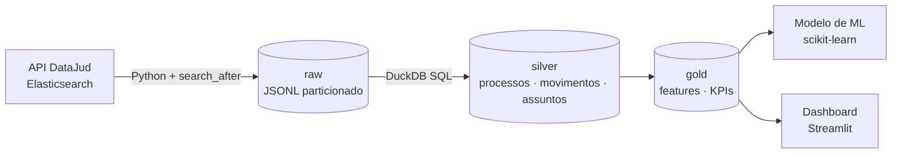

# Tempo de tramitação de processos judiciais — pipeline de dados + ML

Pipeline ponta a ponta sobre **metadados públicos de processos judiciais** da
[API Pública do DataJud (CNJ)](https://datajud-wiki.cnj.jus.br/api-publica/), com o objetivo de
**prever quanto tempo um processo leva até ser encerrado**, usando apenas informações
conhecidas no momento do ajuizamento.

> Status: 🚧 em construção — ingestão e camadas silver/gold prontas; modelo e dashboard a seguir.

## Arquitetura



| Camada | Conteúdo |
|---|---|
| **raw** | Respostas da API sem transformação, em JSONL, particionadas por `tribunal=`, `extracted_at=` e `run=` (uma pasta por execução) |
| **silver** | Processos tipados e deduplicados (versão mais recente de cada processo), movimentos e assuntos explodidos |
| **gold** | `processos_features` (base de modelagem, com o alvo `duracao_dias` + `encerrado` no formato de sobrevivência) e `kpis_classe` |

## Decisões de projeto

- **Raw imutável, lida como JSON bruto.** A camada silver extrai os campos com `->>`, então mudanças
  no schema da API não quebram a ingestão.
- **Paginação com `search_after`.** A API é um Elasticsearch; `from/size` não passa de 10 mil
  resultados, então a paginação usa o `sort` do último documento.
- **Retries só para erros transitórios** (timeout, 429, 5xx), com backoff exponencial. Erros 4xx falham
  na hora.
- **Ingestão retomável.** Cada execução grava numa pasta própria e salva o cursor (`search_after`) em
  `_state.json` depois de cada página; `--resume` continua uma ingestão interrompida sem rebaixar nada.
- **Recorte definido e amostra aleatória.** A base de estudo é um recorte fechado — TJSP, 1º grau,
  Procedimento Comum Cível (classe 7), ajuizados de 2015 a 2019, cerca de 640 mil processos — do qual
  se tira uma amostra aleatória simples e reprodutível (`random_score` com semente). Pegar os primeiros
  N da API enviesa a amostra para os documentos indexados há mais tempo.
- **Paginação sem buracos.** A ordenação termina sempre no `id` do documento, para que `search_after`
  não pule processos com o mesmo valor de ordenação na virada da página.
- **Sem vazamento de dados.** As features usam só atributos conhecidos no ajuizamento (classe,
  assunto, órgão, data).
- **Encerramento robusto a reaberturas.** Pela [TPU do CNJ](https://www.cnj.jus.br/sgt/consulta_publica_movimentos.php),
  o fim é Baixa Definitiva (22) ou Arquivamento Definitivo (246), e a reabertura é Reativação (849) ou
  Desarquivamento (893). O processo só conta como encerrado se o último evento de fim não foi seguido
  de reabertura, e a data é a desse último evento.
- **Alvo de sobrevivência, com censura na data certa.** Processos não encerrados entram como
  censurados na *data de corte* — a última atualização do processo na API —, não na data de hoje: a
  base pública não é atualizada diariamente, e usar hoje inventaria tempo não observado.
- **Checagens de qualidade no `transform`** ([quality.py](src/datajud_pipeline/quality.py)). Regras
  de nível *erro* (chave duplicada, duração negativa, sigiloso na base…) interrompem o pipeline; as de
  nível *aviso* registram problemas da fonte, como datas inconsistentes, e quantos processos saíram.
- **Processos sigilosos (qualquer nível de 1 a 5) são excluídos** da base de modelagem.
- **Custo zero.** Roda localmente e no GitHub Actions com DuckDB.

## Como rodar

```bash
make setup                       # cria o venv e instala as dependências (no Windows: python -m venv .venv; .venv\Scripts\Activate.ps1; pip install -e ".[dev]")
cp .env.example .env             # chave pública da API (confira a vigente na wiki do CNJ)
make ingest TRIBUNAL=tjsp MAX_DOCS=5000
make transform                   # gera data/warehouse.duckdb
make test
```

Amostra aleatória de 30 mil processos do recorte de estudo (a mesma semente sempre gera a mesma
amostra; `--max-docs 0` baixa o recorte inteiro):

```bash
datajud ingest --tribunal tjsp --classe 7 --grau G1 --ajuizado-desde 2015-01-01 --ajuizado-ate 2020-01-01 --amostra-seed 42 --max-docs 30000
```

Se a ingestão for interrompida (timeout, queda de rede), continue de onde parou com os mesmos filtros:

```bash
datajud ingest --tribunal tjsp --resume
```

Consultar o resultado:

```bash
duckdb data/warehouse.duckdb "SELECT * FROM gold.kpis_classe LIMIT 10"
```

## Estrutura

```
src/datajud_pipeline/
  config.py        # endpoint, chave, diretórios
  ingestion.py     # cliente da API, paginação, retries, gravação raw
  transform.py     # executa os SQLs no DuckDB
  quality.py       # checagens de qualidade rodadas no fim do transform
  sql/             # raw → silver → gold
tests/             # testes offline com fixture da API
```

## Próximos passos

- [ ] Modelo de regressão/sobrevivência para `dias_ate_encerramento` (scikit-learn), com validação temporal
- [ ] Dashboard em Streamlit Community Cloud
- [ ] Orquestração agendada com GitHub Actions
- [ ] Infraestrutura equivalente na AWS em Terraform (S3, Glue, Athena, Step Functions)

## Dados

Metadados públicos disponibilizados pelo CNJ via API Pública do DataJud. Não há dados pessoais
de partes: a API pública expõe apenas metadados processuais.
