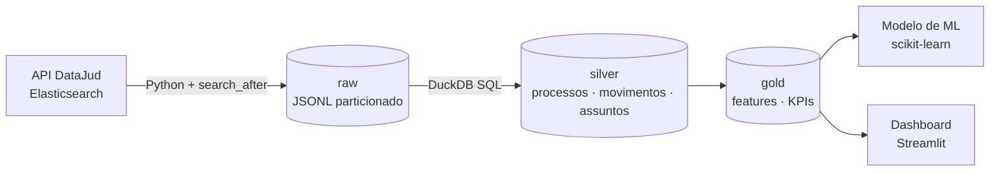

# Tempo de tramitação de processos judiciais — pipeline de dados + ML

Pipeline ponta a ponta sobre **metadados públicos de processos judiciais** da
[API Pública do DataJud (CNJ)](https://datajud-wiki.cnj.jus.br/api-publica/), com o objetivo de
**prever quanto tempo um processo leva até ser encerrado**, usando apenas informações
conhecidas no momento do ajuizamento.

> Status: 🚧 em construção — ingestão e camadas silver/gold prontas; modelo e dashboard a seguir.

## Arquitetura



| Camada | Conteúdo |
|---|---|
| **raw** | Respostas da API sem transformação, em JSONL, particionadas por `tribunal=` e `extracted_at=` |
| **silver** | Processos tipados e deduplicados (versão mais recente de cada processo), movimentos e assuntos explodidos |
| **gold** | `processos_features` (base de modelagem, com a variável-alvo `dias_ate_encerramento`) e `kpis_classe` |

## Decisões de projeto

- **Raw imutável, lida como JSON bruto.** A camada silver extrai os campos com `->>`, então mudanças
  no schema da API não quebram a ingestão.
- **Paginação com `search_after`.** A API é um Elasticsearch; `from/size` não passa de 10 mil
  resultados, então a paginação usa o `sort` do último documento.
- **Retries só para erros transitórios** (timeout, 429, 5xx), com backoff exponencial. Erros 4xx falham
  na hora.
- **Sem vazamento de dados.** As features usam só atributos conhecidos no ajuizamento (classe,
  assunto, órgão, município, data). O encerramento é o primeiro movimento de baixa ou arquivamento
  definitivo na [TPU do CNJ](https://www.cnj.jus.br/sgt/consulta_publica_movimentos.php)
  (códigos 22 e 246).
- **Processos sigilosos são excluídos** da base de modelagem.
- **Custo zero.** Roda localmente e no GitHub Actions com DuckDB.

## Como rodar

```bash
make setup                       # cria o venv e instala as dependências
cp .env.example .env             # chave pública da API (confira a vigente na wiki do CNJ)
make ingest TRIBUNAL=tjsp MAX_DOCS=5000
make transform                   # gera data/warehouse.duckdb
make test
```

Filtrar por classe processual e data de ajuizamento:

```bash
datajud ingest --tribunal tjsp --classe 7 --ajuizado-desde 2018-01-01 --max-docs 20000
```

Consultar o resultado:

```bash
duckdb data/warehouse.duckdb "SELECT * FROM gold.kpis_classe LIMIT 10"
```

## Estrutura

```
src/datajud_pipeline/
  config.py        # endpoint, chave, diretórios
  ingestion.py     # cliente da API, paginação, retries, gravação raw
  transform.py     # executa os SQLs no DuckDB
  sql/             # raw → silver → gold
tests/             # testes offline com fixture da API
```

## Próximos passos

- [ ] Modelo de regressão/sobrevivência para `dias_ate_encerramento` (scikit-learn), com validação temporal
- [ ] Dashboard em Streamlit Community Cloud
- [ ] Orquestração agendada com GitHub Actions
- [ ] Infraestrutura equivalente na AWS em Terraform (S3, Glue, Athena, Step Functions)

## Dados

Metadados públicos disponibilizados pelo CNJ via API Pública do DataJud. Não há dados pessoais
de partes: a API pública expõe apenas metadados processuais.
